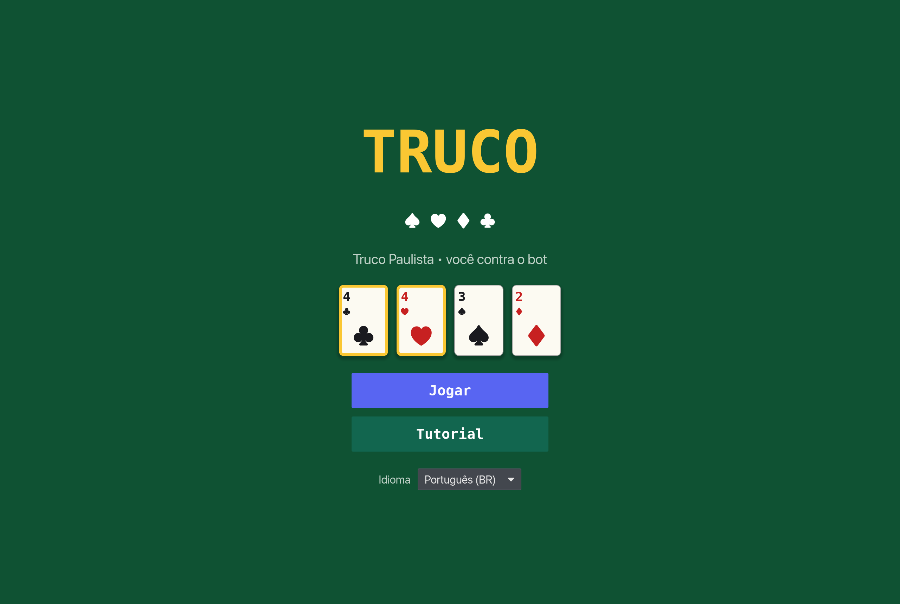
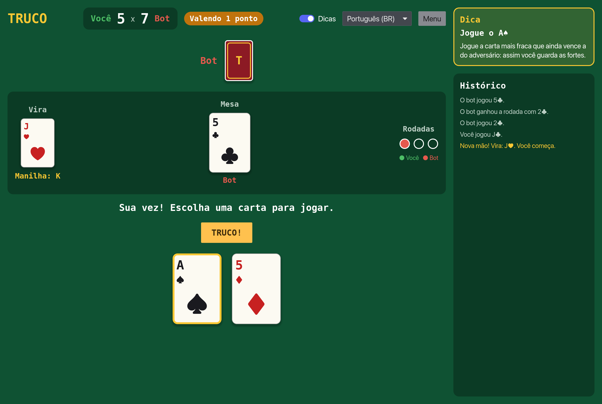
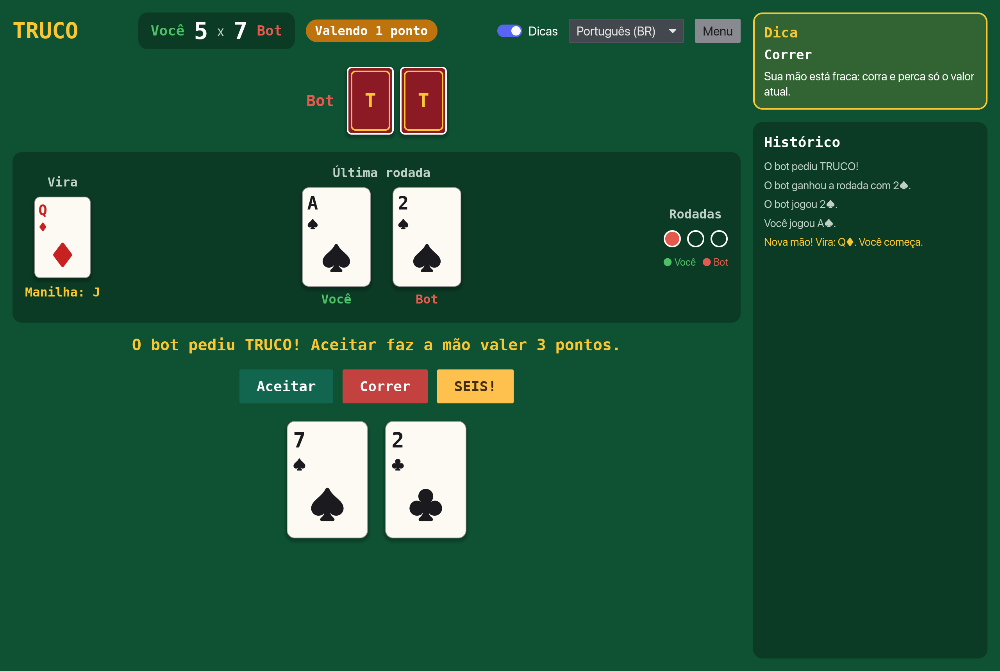
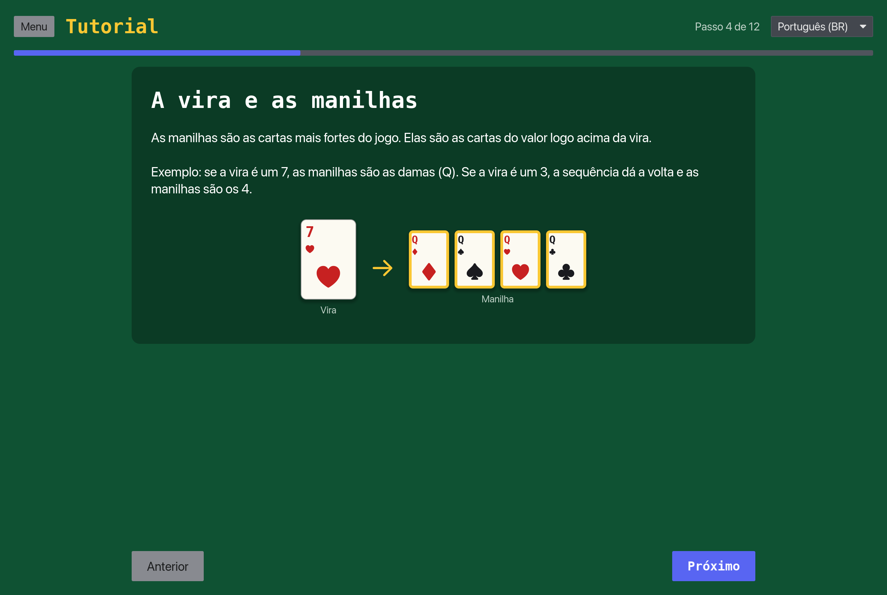
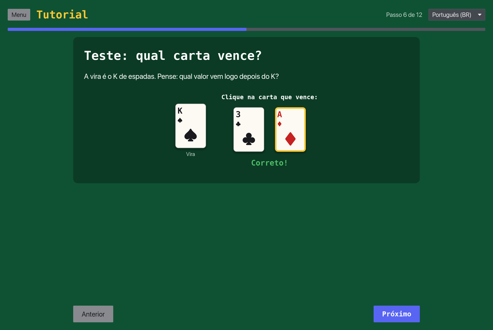
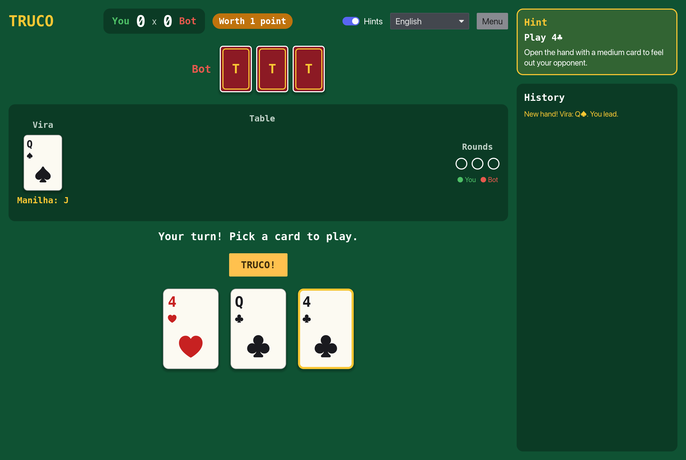

# Truco

A desktop **Truco Paulista** card game written in Rust with [iced](https://iced.rs). Play one-on-one against a bot, and learn the rules with a step-by-step interactive tutorial.

The app ships in **Brazilian Portuguese** by default and can be switched to **English** at any time.



## Features

- **Full Truco Paulista rules (1 vs 1)**
  - 40-card deck (no 8s, 9s, 10s or jokers), 3 cards per player
  - The *vira* and *manilhas*: the rank right after the vira beats everything, ordered by suit ♦ < ♠ < ♥ < ♣ (the *zap*)
  - Best of 3 rounds per hand, with the classic tie rules
  - Raising: **Truco → Six → Nine → Twelve**. Accept, run or raise back.
  - *Mão de onze* (hand of eleven) and *mão de ferro* (iron hand)
  - First to 12 points wins
- **Bot opponent** that plays its cards efficiently, judges when to call or accept truco, and bluffs now and then
- **Hints**: turn them on to get a suggested move and an explanation of why it is a good one
- **Step-by-step tutorial** with illustrated cards and quick quizzes
- **Two languages**: Português (BR) and English

## Screenshots

| Playing with hints | The bot calls truco |
| --- | --- |
|  |  |

| Tutorial | Tutorial quiz |
| --- | --- |
|  |  |

The game in English:



## Getting started

Requirements: [Rust](https://rustup.rs) (the toolchain version is pinned in `rust-toolchain.toml` and installed automatically by rustup).

```sh
cargo run --release
```

If you use [mise](https://mise.jdx.dev), the usual tasks are available:

```sh
mise cli      # run the app
mise test     # run the tests
mise lint     # clippy
mise fmt      # check formatting
```

### Regenerating the screenshots

The screenshots are taken by the app itself. Build it with the `screenshots` feature and it walks through a scripted tour, saves PNGs to `docs/screenshots/` and quits:

```sh
cargo run --features screenshots
```

## How to play (quick version)

1. Each hand you get 3 cards and a *vira* is turned face up. The manilhas are the cards of the rank right after the vira.
2. Card strength, weakest to strongest: `4 5 6 7 Q J K A 2 3`, then the manilhas.
3. Each player plays one card per round. Win 2 of the 3 rounds to win the hand.
4. A hand is worth 1 point. On your turn you can call **Truco** to raise it to 3, and the opponent can raise back to 6, 9 and 12.
5. First to 12 points wins the match.

The in-app tutorial explains all of this in detail, including ties and the hand of eleven.

## Project structure

```
src/
├── main.rs          # app entry point
├── bot.rs           # heuristic opponent (also powers the hints)
├── i18n.rs          # Portuguese and English text
├── game/
│   ├── card.rs      # suits, ranks, cards, deck, strength with the vira
│   └── engine.rs    # match state machine: tricks, raises, scoring
└── ui/
    ├── mod.rs       # iced application: state, messages, update
    ├── menu.rs      # main menu
    ├── table.rs     # game screen
    ├── tutorial.rs  # step-by-step tutorial and quizzes
    ├── widgets.rs   # cards, panels and colors
    └── capture.rs   # screenshot tour (feature `screenshots`)
```
