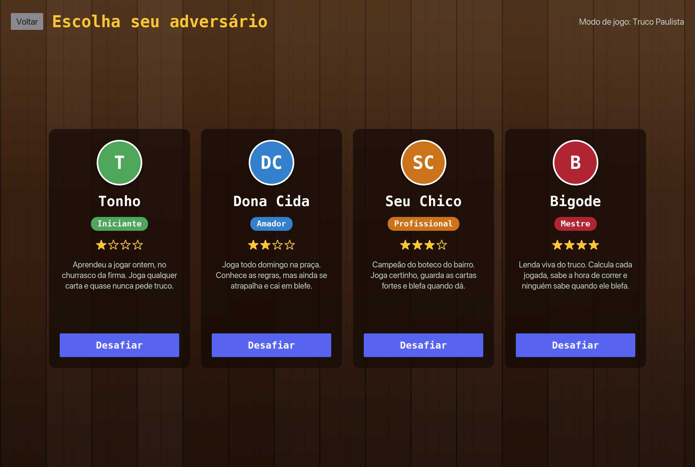
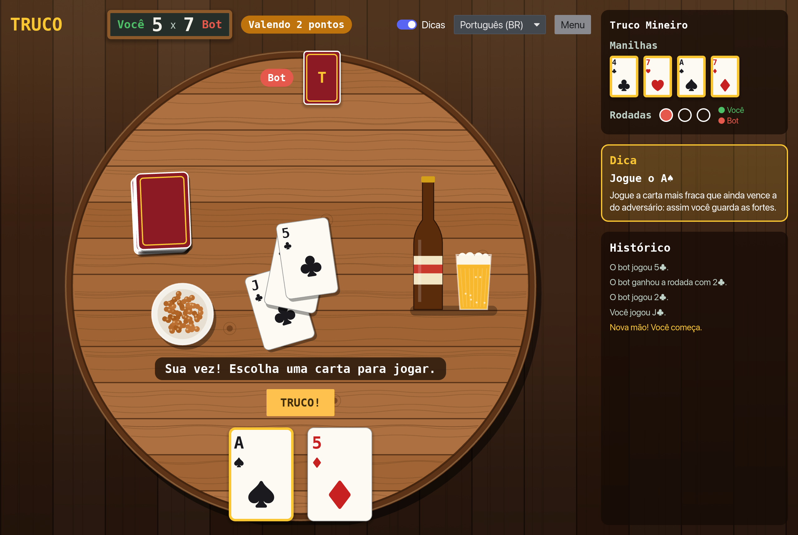

# Truco

A desktop **Truco** card game written in Rust with [iced](https://iced.rs). Play one-on-one against a bot in **Truco Paulista** or **Truco Mineiro**, at a round table in a Brazilian *boteco*, and learn the rules with a step-by-step interactive tutorial.

**Website and downloads: https://joaolfp.github.io/truco/**

The app ships in **Brazilian Portuguese** by default and can be switched to **English** at any time.


## Features

- **Two game modes**, picked in the main menu:

  | | Truco Paulista | Truco Mineiro |
  | --- | --- | --- |
  | Manilhas | Rank after the *vira*, ordered ♦ < ♠ < ♥ < ♣ | Fixed: 4♣ (zap) > 7♥ > A♠ (espadilha) > 7♦ (pica-fumo) |
  | Raise ladder | 1 → 3 → 6 → 9 → 12 | 2 → 4 → 8 → 10 → 12 |
  | Special hand | *Mão de onze* (11 points) | *Mão de dez* (10 points) |

- **Truco Paulista rules in detail (1 vs 1)**
  - 40-card deck (no 8s, 9s, 10s or jokers), 3 cards per player
  - The *vira* and *manilhas*: the rank right after the vira beats everything, ordered by suit ♦ < ♠ < ♥ < ♣ (the *zap*)
  - Best of 3 rounds per hand, with the classic tie rules
  - Raising: **Truco → Six → Nine → Twelve**. Accept, run or raise back.
  - *Mão de onze* (hand of eleven) and *mão de ferro* (iron hand)
  - First to 12 points wins
- **Four fictional opponents**, picked before each match:

  | Opponent | Level | How they play |
  | --- | --- | --- |
  | Tonho | ★☆☆☆ Beginner | Often plays a random card, misjudges his hand, never bluffs |
  | Dona Cida | ★★☆☆ Amateur | Knows the basics but misreads hands and rarely bluffs |
  | Seu Chico | ★★★☆ Professional | Textbook play: beats cheaply, saves strong cards, bluffs sometimes |
  | Bigode | ★★★★ Master | Before every decision, simulates hundreds of possible deals using only the cards he hasn't seen (no cheating) and picks the move with the best expected points |
- **Hints**: turn them on to get a suggested move and an explanation of why it is a good one
- **Step-by-step tutorial** with illustrated cards and quick quizzes
- **Two languages**: Português (BR) and English

## Screenshots



| Playing with hints | The bot calls truco |
| --- | --- |
|  |  |

| Tutorial | Tutorial quiz |
| --- | --- |
|  |  |

| Truco Mineiro | In English |
| --- | --- |
|  |  |

## Download

Grab the installer for your system from the [latest release](https://github.com/joaolfp/truco/releases/latest). No terminal needed:

| System | File |
| --- | --- |
| Windows 10/11 | [`Truco-Windows-Setup.exe`](https://github.com/joaolfp/truco/releases/latest/download/Truco-Windows-Setup.exe) |
| macOS 11+ (Apple Silicon and Intel) | [`Truco-macOS.dmg`](https://github.com/joaolfp/truco/releases/latest/download/Truco-macOS.dmg) |
| Linux (x86_64) | [`Truco-Linux-x86_64.AppImage`](https://github.com/joaolfp/truco/releases/latest/download/Truco-Linux-x86_64.AppImage) or [`Truco-Linux-amd64.deb`](https://github.com/joaolfp/truco/releases/latest/download/Truco-Linux-amd64.deb) |

The installers are not signed yet, so the first launch shows a warning:

- **Windows**: on "Windows protected your PC", click *More info → Run anyway*.
- **macOS**: if the app is blocked, open *System Settings → Privacy & Security* and click *Open Anyway*.

## Install with Cargo

Requirements: [Rust](https://rustup.rs). The toolchain version is pinned in `rust-toolchain.toml` and installed automatically by rustup.

```sh
cargo install --git https://github.com/joaolfp/truco
```

Then start the game:

```sh
truco
```

### Run from source

```sh
git clone https://github.com/joaolfp/truco
cd truco
cargo run --release
```

## How to play (quick version)

1. Each hand you get 3 cards and a *vira* is turned face up. The manilhas are the cards of the rank right after the vira.
2. Card strength, weakest to strongest: `4 5 6 7 Q J K A 2 3`, then the manilhas.
3. Each player plays one card per round. Win 2 of the 3 rounds to win the hand.
4. A hand is worth 1 point. On your turn you can call **Truco** to raise it to 3, and the opponent can raise back to 6, 9 and 12.
5. First to 12 points wins the match.

In **Truco Mineiro** there is no vira: the manilhas are always 4♣ > 7♥ > A♠ > 7♦, hands start at 2 points (truco 4, six 8, nine 10, twelve 12) and the special hand happens at 10 points.

The in-app tutorial explains all of this in detail, including ties, the hand of eleven and the Mineiro differences.

## Development

Architecture, project structure, development commands and the release process are covered in the [technical documentation](docs/README.md).
